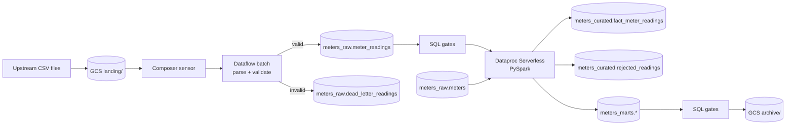

# gcp-smart-meter-analytics
Batch data platform on GCP: Cloud Storage → Dataflow (Beam) → BigQuery → Dataproc Serverless (PySpark) → marts, orchestrated by Cloud Composer, with dead-letter handling, SQL quality gates and anomaly detection.
# Smart-Meter Analytics Platform on GCP

**Cloud Storage → Dataflow → BigQuery → Dataproc Serverless (Spark) → BigQuery marts, orchestrated by Cloud Composer**

A batch data platform for an electricity utility. Smart-meter reading files land in Cloud Storage. A Cloud Composer (Airflow) DAG detects them, runs a Dataflow job that validates every row, then a Dataproc Serverless Spark job that deduplicates, enriches, flags abnormal consumption with rolling-window statistics and builds analytics marts. SQL quality gates sit between the stages, and processed files are archived.

## Architecture



| Stage | Tool | Responsibility |
|---|---|---|
| Land | Cloud Storage | `meters/landing/` for incoming files, `meters/archive/` after success, `meters/code/` for job scripts |
| Ingest | Dataflow (Apache Beam, Python) | Row-level parsing and validation, dead-letter routing, load into BigQuery |
| Store | BigQuery | Raw, curated and mart datasets in `asia-south1` |
| Transform | Dataproc Serverless (PySpark) | Deduplication, reference-data checks, rolling 7-day statistics, anomaly flags, completeness, aggregates |
| Orchestrate | Cloud Composer 3 (Airflow) | File sensor, Beam and Dataproc operators, SQL quality gates, archiving |

## The DAG

`wait_for_files → ingest_dataflow → [check_raw_loaded, check_reject_ratio] → transform_spark → check_marts → archive_landing_files → end`

| Task | What it does |
|---|---|
| `wait_for_files` | Waits (reschedule mode) for files named `meter_readings_*` under `meters/landing/` |
| `ingest_dataflow` | Submits the single-file Beam pipeline to Dataflow with Beam pinned in a temporary virtualenv |
| `check_raw_loaded` | Fails if the raw table is empty |
| `check_reject_ratio` | Fails if more than 10% of ingested rows were rejected |
| `transform_spark` | Runs the PySpark job as a Dataproc Serverless batch |
| `check_marts` | Fails if the fact table has duplicate ids, negative kWh, or does not reconcile with the feature table |
| `archive_landing_files` | Moves the processed CSVs to `meters/archive/` |

## Data

`data/landing/` holds 4 CSV files with **400 data rows**, reproducible with `python data/generate_data.py`. The dimension `data/meters.csv` holds 20 meters (12 residential, 5 commercial, 3 industrial) across 5 cities.

| Rows | What |
|---|---|
| 388 | Unique readings: 384 for known meters and 4 for an unknown meter (`MTR-099`) |
| 6 | Exact duplicates (re-delivered rows) |
| 6 | Invalid rows: missing meter id, negative kWh, non-numeric kWh, impossible date, wrong column count, voltage out of range |

The unique readings also contain 8 injected consumption spikes and 16 missing meter-days.

**Expected results after a full run**

| Table | Expect |
|---|---|
| `meters_raw.meter_readings` | 394 rows (388 unique) |
| `meters_raw.dead_letter_readings` | 6 rows, each with the reason |
| `meters_curated.fact_meter_readings` | 384 rows |
| `meters_curated.rejected_readings` | 4 rows (`unknown_meter`) |
| `meters_marts.anomaly_report` | 7 rows (6 HIGH) |
| `meters_marts.meter_completeness` | 20 rows, 16 missing days in total |
| `meters_marts.daily_city_consumption` | 253 rows |

The Spark job on Dataproc Serverless (runtime 2.2) took **3 min 50 s** in the Composer-launched run.

## Design decisions

1. **Why both Dataflow and Dataproc?** Dataflow is serverless and autoscaling, ideal for record-level ingestion where each row is validated independently and bad rows are routed aside. Spark suits set-based analytics: windowed statistics, joins with reference data, aggregations. Many teams would choose one tool for a pipeline this small. This project uses both on purpose, each where it fits best.
2. **Dead-letter, don't drop.** Invalid lines are written to `dead_letter_readings` with the original line, source file and reason.
3. **Idempotent by design.** The Dataflow job appends, so a rerun can duplicate rows. Spark deduplicates on `reading_id` (latest ingest wins), and files are archived only after everything else succeeds.
4. **Two kinds of validation.** Syntactic checks live in Dataflow; referential checks (unknown meter) live in Spark, where the dimension table is available.
5. **Anomaly detection without ML.** Each reading is compared with the meter's previous 7 calendar days (at least 5 readings needed). It is flagged when the z-score is 3 or higher, or when consumption is at least 3 times the rolling average.
6. **Quality gates fail the pipeline.** SQL checks use BigQuery's `ERROR()` so a violation fails the Airflow task and stops downstream work.
7. **Variables read at parse time.** BigQuery operators in Airflow do not template `location`, so project, region and bucket come from Airflow Variables, with a visible `CHANGE_ME` default so a missing variable fails loudly.
8. **Testable logic.** Validation and the Spark transformations are plain functions covered by unit tests that run in CI (including a local Spark session).

**Honest scale note:** 400 rows does not need Dataflow, Spark or Composer. The value is the pattern and the operational detail; the same code scales by raising worker counts. In production the Beam job would run from a Flex Template instead of installing Beam at run time.

## Repo layout

```
data/        generator, 4 landing files, meters.csv
dataflow/    ingest_meter_readings.py   (single-file Beam pipeline)
spark/       transform_meter_readings.py
dags/        meter_pipeline_dag.py
sql/         DDL, meters seed, verification queries
tests/       validation, dataset and Spark logic tests
.github/     CI: ruff + pytest (Java + PySpark)
docs/        screenshots
```

## How to run it

**Prerequisites:** a GCP project with billing, the Composer, Dataflow, Dataproc, BigQuery, Storage and IAM Service Account Credentials APIs enabled, and a service account with Dataflow Admin, Dataproc Editor/Worker, BigQuery Data Editor/Job User/Read Session User, Storage Object Admin, Composer Worker and Service Account User.

1. **BigQuery:** create the datasets `meters_raw`, `meters_curated` and `meters_marts` in `asia-south1` through the console, then run `sql/01_create_tables.sql` and `sql/02_seed_meters.sql` (replace `${PROJECT_ID}`).
2. **Cloud Storage:** upload `dataflow/ingest_meter_readings.py` and `spark/transform_meter_readings.py` to `gs://<bucket>/meters/code/`.
3. **Composer:** create a Composer 3 environment in `asia-south1`, set the Airflow Variables `gcp_project`, `gcp_region` and `lake_bucket`, and upload `dags/meter_pipeline_dag.py`.
4. **Run:** upload the four CSVs to `gs://<bucket>/meters/landing/`, trigger `meter_pipeline_daily`, then run `sql/03_verification_queries.sql`.
5. **Clean up:** delete the Composer environment, since it bills while it exists.

**Dataflow fallback** if a zone is out of capacity: set the Airflow Variable `dataflow_zone` (for example `asia-south1-b`), or run the same pipeline without worker VMs from Cloud Shell:

```bash
python
